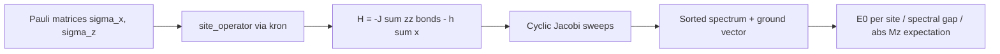
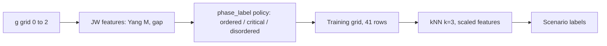
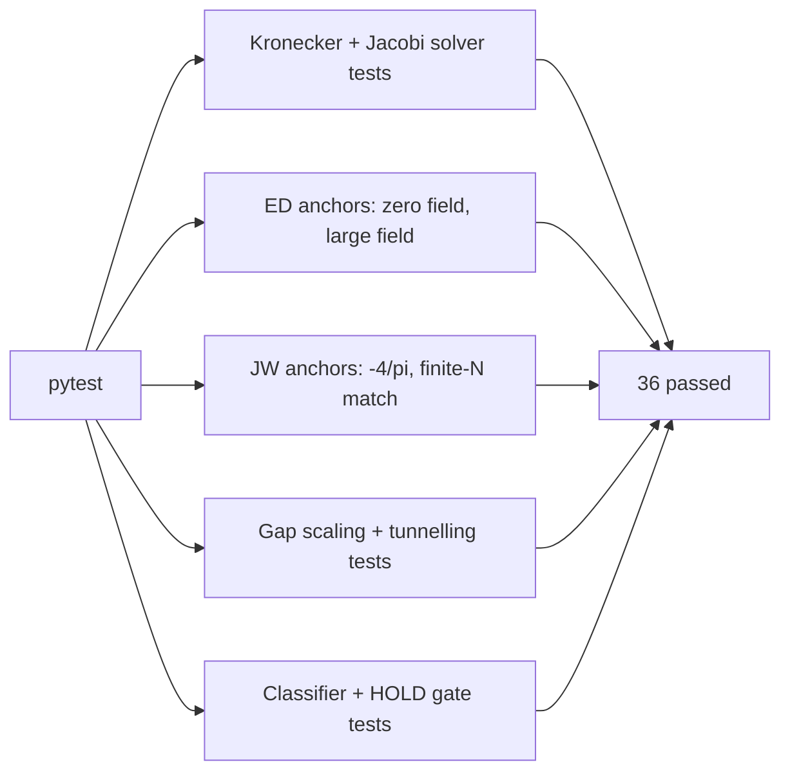
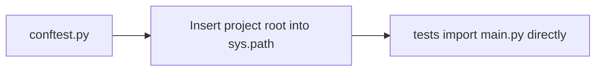
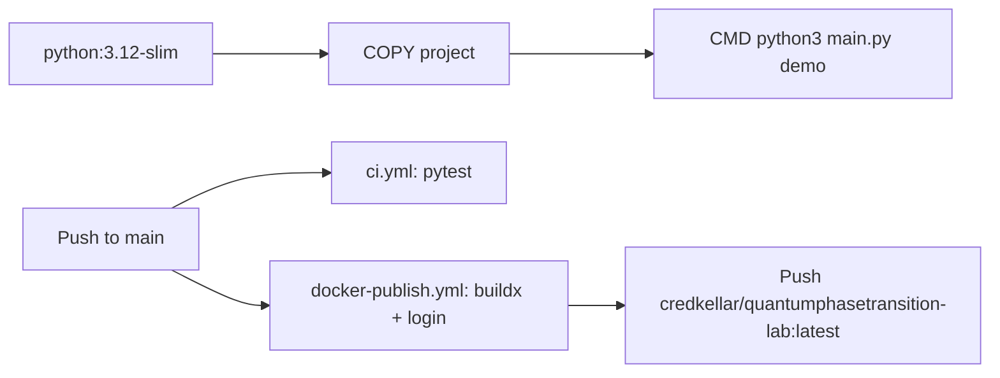

# QuantumPhaseTransition-Lab 🌡️⚛️

**Transverse-Field Ising Quantum Phase Transition Lab** — by Darion Kellar

QuantumPhaseTransition-Lab is an **educational quantum phase transition lab** in ONE pure-Python file. It studies exactly one model — the **one-dimensional transverse-field Ising model (TFIM)**, `H = −J Σ σzσz − h Σ σx` on a ring — with **two independent engines that cross-check each other**:

- **Exact diagonalization (ED)** — the full `2^N × 2^N` Hamiltonian built from Kronecker products and diagonalized by a from-scratch Jacobi eigensolver (N ≤ 7, 128×128 max): ground energy, spectral gap, and `⟨|Mz|⟩`.
- **Jordan–Wigner / Bogoliubov solution** — the standard free-fermion formulas implemented in code: dispersion `ε(k) = 2√(J² + h² − 2Jh cos k)`, thermodynamic-limit ground energy, and the quasiparticle gap `2|J − h|` that **closes exactly at h = J**.

The headline result is the agreement: the finite-N Jordan–Wigner sum reproduces the ED ground energy to **~1e-8 at every N** — because the 1D TFIM is **exactly solvable**, and this lab says so in its first paragraph. The gap tells two honest stories: the quasiparticle gap closes at the critical point `g = h/J = 1`, while a finite ring's raw spectral gap collapses **exponentially** inside the ordered phase (tunnelling between the two symmetry-broken sectors) and closes only like **π/(2N)** exactly at criticality. The spontaneous magnetization is the **labelled Onsager–Yang formula** `(1 − g²)^(1/8)`, printed next to the ED `⟨|Mz|⟩` that trends toward it. 🔬

Honest scope, stated up front: **no unsolved model is solved here, no real material is predicted, fitted, or measured.** Every materials / hardware / sensor / prediction claim sits behind a permanent HOLD gate (14 total). 🔒

[](https://github.com/kimanicollier44-cmyk/QuantumPhaseTransition-Lab/actions/workflows/ci.yml)
[](https://github.com/kimanicollier44-cmyk/QuantumPhaseTransition-Lab/actions/workflows/docker-publish.yml)

> ℹ️ These are the **live** workflow badges for this repo. They activate as soon as the `ci.yml` and `docker-publish.yml` files from the paste pack are pasted into `.github/workflows/` — until then they have nothing to report yet.

## 🧰 Tech Stack Badges & Full Architecture Tech Stack

### 💻 Core Programming Languages & Core Systems


- 🐍 Python 3.12, pure standard library (`math`, `hashlib`, `json`, `sys`) — zero dependencies, zero network, deterministic (double-run byte-identical)
- 🧮 Exact diagonalization core: Kronecker-product Hamiltonian construction + a from-scratch cyclic Jacobi eigensolver (reconstruction `VΛVᵀ` asserted to < 1e-9 in CHECKS)
- 🌀 Jordan–Wigner engine: Bogoliubov dispersion, Simpson-rule thermodynamic energy integral (4,000 intervals), finite-N antiperiodic momentum sums
- 🧠 TinyML kNN phase classifier (from scratch, stdlib): ordered / critical-region / disordered from (g, magnetization, gap), labels from the lab's own JW phase policy
- 🪑 Council seats: Gemini Argon 4 DECIDER (names-only, tighten-only) + Muse advisor (never overrides HOLD) + Google Flow plan-only (rendered = False, live = 0)

### ⛓️ Web3 & Infrastructure

- 🚫 **Not applicable — honestly.** No blockchain, no Web3, no tokens: the "infrastructure" in this lab is one offline file, a diagonalization, and an integral. No fake badges here.

### ⚙️ Platform Support & Hardware Architecture


- 🖥️ Pure Python — runs anywhere Python 3.12+ runs (Linux, macOS, Windows), plus the `python:3.12-slim` Docker image
- 🔒 No hardware is controlled or modelled as a result, ever: a 7-spin laptop diagonalization is not a quantum hardware result (HOLD gate, see below)

### ⚡ Low-Level Infrastructure & Performance

- 🚫 **No low-level code — honestly.** No C, no C++, no GPU, no compiled extensions: one interpreted Python file on purpose, so every eigenvalue can be read, checked, and diffed. Performance here means honest algorithms — a Jacobi eigensolver, memoized diagonalizations shared by demo/checks/tests, and a 4,000-interval Simpson integral that nails −4/π to < 1e-6.

### 🛠️ DevOps & Build Tools


- 🐳 Docker (`python:3.12-slim`), GitHub Actions CI + Docker Publish (delivered in the paste pack)
- 🎯 Target image: `credkellar/quantumphasetransition-lab:latest`
- 🧪 Tests: `pytest` (36 tests) + the built-in CHECKS suite (49 checks) in `main.py`

### ☁️ Cloud Providers

- 🚫 **None — honestly.** No cloud provider is used or needed: the lab runs fully offline on your own machine or in a local Docker container. Docker Hub appears only as the registry the publish workflow pushes the image to.

## What this does?

1. 🏗️ **Builds the full Hamiltonian** — `H = −J Σ σzσz − h Σ σx` on a ring, assembled from Kronecker products of Pauli matrices (σz bonds contribute through their diagonals, σx in full). The matrix is asserted symmetric and traceless in CHECKS.
2. 🔍 **Diagonalizes it exactly** — a from-scratch cyclic Jacobi eigensolver (no libraries) returns the full spectrum and eigenvectors for N ≤ 7; the solver itself is graded by reconstructing `VΛVᵀ` to < 1e-9 and by the known 2×2 spectrum {1, 3}.
3. 📈 **Scans the field at N = 6** — ground energy per site, spectral gap, and `⟨|Mz|⟩` for g = 0 → 2: energy falls from −1.000000 to −2.128232 per site, `⟨|Mz|⟩` from 1.0000 to 0.4514, and the ED energy tracks the Jordan–Wigner curve at every point.
4. 🌀 **Runs the Jordan–Wigner engine** — dispersion `ε(k) = 2√(J² + h² − 2Jh cos k)`, the thermodynamic ground energy by Simpson integration (−1 at g = 0, **−4/π = −1.273240 at g = 1**, asserted to < 1e-6), and the finite-N antiperiodic sum `E0 = −½ Σ ε(k)`.
5. 🤝 **Cross-checks the two engines** — the finite-N JW sum lands on the ED ground energy to **~1e-8 at every N ∈ {4, 5, 6, 7}** and both fields g ∈ {0.5, 1.0}; meanwhile ED walks toward the thermodynamic JW value as N grows (|ED − thermo| at g = 1: 3.33e-02 → 2.12e-02 → 1.47e-02 → 1.07e-02).
6. 🕳️ **Tells gap story one: quasiparticle closure** — the thermodynamic quasiparticle gap `2|J − h|` is 1.000 at g = 0.5, 0.200 at g = 0.9, **exactly 0 at g = 1**, and reopens to 1.000 at g = 1.5. The gap closes *at* the transition — that is what makes it a transition.
7. 🐜 **Tells gap story two: tunnelling** — inside the ordered phase, the finite ring's raw spectral gap is the tunnelling splitting between the two symmetry-broken sectors, and it collapses exponentially: 0.035490 → 0.015402 → 0.006892 → 0.003146 for N = 4 → 7 at g = 0.5 (each step < 0.6× the last).
8. 🎯 **Measures the critical finite-size gap** — exactly at g = 1 the ED gap closes only algebraically: gap × N = 1.5913, 1.5838, 1.5798, 1.5774 for N = 4 → 7, settling toward **π/2 = 1.5708** — the finite-size shadow of a gapless point, distinct from the JW fermion gap 4 sin(π/2N) printed beside it.
9. 🧲 **Prints the order parameter honestly** — the labelled Onsager–Yang curve `M = (1 − g²)^(1/8)` (1.0000 at g = 0, 0.9647 at g = 0.5, 0 for g ≥ 1) next to ED `⟨|Mz|⟩`, which approaches it with N: at g = 0.5, N = 7 gives 0.9636 vs the Yang 0.9647. The correlation-length proxy ξ = 1/|1 − g| diverges at g = 1 (2 → 10 → 100 → ∞).
10. 🏷️ **Classifies phases + seats + checks** — a from-scratch kNN labels (g, M, gap) points ordered / critical-region / disordered using the lab's own JW-labelled grid (k = 3, because the 1/8-exponent magnetization plunge would otherwise let the disordered side outvote the critical point), with Argon 4 DECIDER (sha256 trace), Muse advisor, Google Flow plan-only, and a built-in CHECKS suite (49 checks).

## 🗺️ How it works — diagram per script

### `main.py` — the whole lab

```mermaid
flowchart TD
    A[CLI: demo / checks / ed / jw / gap / phases] --> B[Kronecker Hamiltonian Builder]
    B --> C[Jacobi Eigensolver]
    C --> D[ED Book: E0, gap, abs Mz]
    A --> E[Jordan-Wigner: dispersion eps k]
    E --> F[Thermodynamic Integral + Finite-N Sums]
    F --> G[JW Book: E0, gap 2|J-h|, Yang M, xi]
    D --> H{ED vs JW Cross-Check}
    G --> H
    H --> I[Gap Stories: closure / tunnelling / pi over 2N]
    H --> J[kNN Phase Classifier]
    J --> K[Argon 4 DECIDER + Claude Advisor]
    K --> L{HOLD Gates x14}
    L -->|materials / hardware / prediction| M[HOLD - exit 2]
    L -->|sandbox sim| N[CHECKS + VERDICT PROCEED]
```

### ED engine — full Hamiltonian diagonalization



### Jordan–Wigner engine — free-fermion solution

```mermaid
flowchart LR
    A[g = h/J] --> B[eps k = 2 sqrt of J2 + h2 - 2Jh cos k]
    B --> C[Simpson integral: E0 thermo per site]
    B --> D[Antiperiodic k sum: E0 finite-N]
    B --> E[Gap 2|J - h| + Yang M + xi proxy]
    C --> F[Labelled textbook results]
    D --> F
    E --> F
```

### Gap analysis — the two stories

```mermaid
flowchart TD
    A[ED spectral gaps] --> B[Ordered side: tunnelling collapse vs N]
    A --> C[At g = 1: gap x N toward pi/2]
    A --> D[Disordered side: reopens, tracks 2|J-h|]
    E[JW quasiparticle gap] --> F[Closes exactly at g = 1]
    B --> G[Phase picture]
    C --> G
    D --> G
    F --> G
```

### Phase classifier — kNN over the JW grid



### `tests/test_main.py` — verification



### `conftest.py` — test path setup



### `Dockerfile` + CI flow — container & publish



## Why is this cool?

1. 🤝 Two completely different engines — brute-force diagonalization and a fermion transformation — agree on the ground energy to **eight decimal places** at every size tested. That is what a *solved* model looks like, and the lab shows the receipts instead of asking you to believe either engine.
2. 🕳️ The gap doesn't just "get small" at the transition — it **closes exactly**, `2|J − h| = 0` at h = J, and reopens symmetrically on the other side. One formula draws the whole phase diagram's spine.
3. 🐜 The ordered phase hides a second gap story: the finite ring tunnels between its two symmetry-broken ground states, and the splitting dies **exponentially** (×0.44 per added spin) — order you can watch becoming permanent as N grows.
4. 🎯 At criticality the gap closes like **π/(2N)**: multiply the measured gaps by N and they settle onto π/2 = 1.5708 (1.5913 → 1.5774). A constant of nature falls out of a 7-spin toy.
5. 🧲 The magnetization vanishes with the famous **1/8 exponent** — `(1 − g²)^(1/8)` stays fat (0.9647 at g = 0.5, still 0.8125 at g = 0.9) and then drops off a cliff at g = 1, and the ED `⟨|Mz|⟩` chases it down as N grows.
6. 📏 The correlation length **diverges**: ξ = 2 sites at g = 0.5, 10 at g = 0.9, 100 at g = 0.99, infinite at g = 1 — the precise sense in which a critical system has structure on *every* scale at once.
7. 🔬 The eigensolver is **graded before it is trusted**: reconstruction `VΛVᵀ` < 1e-9, orthonormality < 1e-9, a known 2×2 spectrum — the lab checks its own ruler before measuring anything.
8. 🧊 Zero-field and infinite-field limits are exact anchors, not vibes: at g = 0 the ED energy is −1 per site with a *degenerate* gap (< 1e-8), and by g = 10 the energy sits within 0.1 of the fully polarized −h per site.
9. 🏷️ The classifier has an honest failure mode that got fixed in the open: with k = 5 the flat disordered side outvoted the critical point (the 1/8-plunge makes ordered rows distant), so the lab uses k = 3 and explains why, in the docstring.
10. 🎯 Deterministic end to end: no randomness anywhere — run it twice, get byte-identical output, a phase transition you can diff.

## What problems this solves?

1. ❌ **Problem:** "Quantum phase transition" is usually taught as a picture of a gap closing, with no numbers attached. ✅ **Solution:** Both gaps are computed — the quasiparticle gap closing exactly at g = 1 and the finite-size gap closing like π/(2N) — each with its own table.
2. ❌ **Problem:** Exact diagonalization results are often presented with no independent check. ✅ **Solution:** The Jordan–Wigner finite-N sum reproduces ED to ~1e-8 at four sizes and two fields; either engine failing would break the agreement loudly.
3. ❌ **Problem:** The tunnelling splitting in the ordered phase is routinely confused with the quasiparticle gap. ✅ **Solution:** The lab separates them explicitly — exponential collapse vs N on one side, `2|J − h|` closure on the other — and asserts both behaviours in CHECKS.
4. ❌ **Problem:** Textbook formulas (Onsager–Yang, −4/π) get quoted as decoration. ✅ **Solution:** Each is implemented, evaluated, and graded: −4/π matched to < 1e-6 by the Simpson integral, the Yang curve approached by ED `⟨|Mz|⟩` as N grows.
5. ❌ **Problem:** Finite-size effects are hand-waved as "small corrections". ✅ **Solution:** They are tabulated: |ED − thermodynamic| shrinks 3.33e-02 → 1.07e-02 at criticality from N = 4 → 7, so you can see exactly how far a 7-spin ring is from infinity.
6. ❌ **Problem:** "Exactly solvable" is rarely explained when it is claimed. ✅ **Solution:** The lab states up front that the 1D TFIM is solved, labels the JW formulas as standard results, and HOLD-gates any claim of solving unsolved models (`unsolved_model_solution_claim`).
7. ❌ **Problem:** Critical exponents appear as trivia (β = 1/8) without behaviour. ✅ **Solution:** The magnetization curve is printed across the transition — fat, then cliff — and the classifier's k had to be chosen around that very plunge, which the code explains.
8. ❌ **Problem:** Simulation labs quietly imply materials predictions. ✅ **Solution:** 14 named HOLD gates return exit code 2 for material prediction, superconductor design, sensor specs, hardware results, and tipping-point forecasts, permanently.
9. ❌ **Problem:** Eigensolvers are treated as black boxes whose output is believed. ✅ **Solution:** The Jacobi solver ships with reconstruction and orthonormality assertions in the built-in checks — trust is earned inside the same file.
10. ❌ **Problem:** Phase diagrams in teaching tools are drawn, not derived. ✅ **Solution:** The classifier's training grid is computed by the lab's own JW engine and labelled by its own phase policy — the diagram is an output, not an illustration.

## How to install this?

1. 📋 Clone or download this project folder.
2. 🐍 Make sure Python 3.12+ is installed: `python3 --version`
3. ▶️ Run the full demo + checks (no arguments needed):

```bash
python3 main.py
```

4. 🧪 Run the test suite:

```bash
pip install pytest
python3 -m pytest -q
```

5. 🎛️ Try the other commands:

```bash
python3 main.py checks   # 49 built-in checks
python3 main.py ed       # ED scan at N=6 vs JW (JSON)
python3 main.py jw       # finite-size ED vs JW report (JSON)
python3 main.py gap      # the two gap stories (JSON)
python3 main.py phases   # order parameter + correlation length (JSON)
python3 main.py classify # kNN phase classifier report
python3 main.py brains   # Argon 4 + Muse + Flow seats
python3 main.py holds    # list all 14 HOLD gates
python3 main.py hold-demo # exits 2 - gated actions stay HOLD
```

6. 🐳 Or run it in Docker:

```bash
docker build -t credkellar/quantumphasetransition-lab:latest .
docker run --rm credkellar/quantumphasetransition-lab:latest
```

## Requirements

- 🐍 Python 3.12 or newer
- 📦 Dependencies: **none** (standard library only)
- 🌐 Network: **none** — fully offline
- 🧪 For tests only: `pytest`
- 🐳 Optional: Docker

## FULL project structure tree

```text
quantumphasetransition-lab/
├── main.py                  # the whole lab: Kronecker Hamiltonian, Jacobi eigensolver, ED engine, Jordan-Wigner engine, gap stories, phase classifier, seats, HOLD gates
├── conftest.py              # puts the project root on sys.path for tests
├── tests/
│   └── test_main.py         # 36 pytest tests: linear algebra, ED anchors, JW anchors, gap scaling, tunnelling, classifier, gates, determinism
├── assets/
│   └── cover.png            # README cover image (2736 x 912)
├── Dockerfile               # python:3.12-slim, runs the demo
├── .gitignore               # __pycache__/, .pytest_cache/, *.pyc
└── README.md                # this file
```

> 📦 Delivered separately as paste packs (not in this tree): `.github/workflows/ci.yml` + `docker-publish.yml`, and the Docker Hub pack (100-char description, 350-char About, overview, categories).

## 🔒 HOLD gates — all 14, permanent

| # | Gate | What stays held |
|---|------|-----------------|
| 1 | `unsolved_model_solution_claim` | No claim of solving an unsolved model; the 1D TFIM is exactly solvable and 2D/3D models are not solved here |
| 2 | `real_material_prediction_claim` | No predicting a real material's transition temperature, field, or critical exponents |
| 3 | `superconductor_design_claim` | No superconductor discovery, design, or Tc claim from Ising-model arithmetic |
| 4 | `quantum_hardware_result_claim` | Exact diagonalization of at most 7 spins on a laptop is not a quantum hardware result |
| 5 | `benchmark_supremacy_claim` | No benchmark, supremacy, or advantage claim from toy sizes |
| 6 | `criticality_sensor_claim` | No criticality-enhanced sensor, magnetometer, or metrology specification |
| 7 | `materials_engineering_guidance` | No engineering guidance for real phase-change materials, alloys, or devices |
| 8 | `energy_device_claim` | No energy storage, harvesting, or battery claim from critical phenomena |
| 9 | `financial_tipping_point_claim` | No market crash, contagion, or financial tipping-point prediction |
| 10 | `climate_tipping_point_claim` | No climate or ecological tipping-point forecast from a spin chain |
| 11 | `medical_phase_claim` | No medical, protein-folding, or biological phase-transition claim |
| 12 | `plasma_fusion_claim` | No plasma, fusion, or confinement criticality guidance |
| 13 | `cryptographic_claim` | No cryptographic primitive, key, or security claim from critical phenomena |
| 14 | `thermodynamic_limit_overclaim` | Finite-N numbers are never presented as thermodynamic-limit measurements; labelled JW formulas are never presented as new results |

🧑‍⚖️ **Council seats:** Gemini Argon 4 Extended Thinking — DECIDER (names-only, tighten-only, MAP → MODEL → STRESS → DECIDE, sha256 trace, `can_override_hold = False`) · Muse — advisor (`can_override_hold = False`) · Google Flow — plan-only (`rendered = False`, `live = 0`).

✅ **Verification:** pytest **36 passed** (project + clean copy) · built-in CHECKS **49/49** · double-run output **byte-identical** · `hold-demo` exits **2** · `main.py` **818 lines**, pure stdlib, zero network.

## 🧒 5th-grade English section

Imagine a row of tiny magnets, like fridge magnets in a line. Each magnet wants to point the same way as its neighbours — up with up, down with down. 🧲

- Now imagine a second force that keeps trying to flip every magnet sideways. When that flipping force is weak, the neighbours win: the whole row picks up (or down) together. That is called the **ordered** side. 💪
- When the flipping force is strong, it wins: the magnets give up on agreeing and just wobble sideways on their own. That is the **disordered** side. 🌪️
- Right in the middle, the two forces tie. At that exact tie point, something amazing happens: the row can't decide *at any size* — little groups, medium groups, and huge groups of magnets all hesitate together. Scientists call that tie point a **quantum phase transition**. ⚖️
- This lab does the math for that row of magnets **two completely different ways** — one way checks every possible arrangement one by one, the other way uses a famous shortcut — and the two ways agree to eight decimal places. That agreement is the proof the math is right. 🤝
- The lab also measures the "energy gap" — how much extra energy the first wobble costs. At the tie point the gap shrinks to nothing, like the row becoming perfectly undecided. On the ordered side, the gap shrinks in a sneaky second way: the row slowly *tunnels* between all-up and all-down, and the bigger the row, the slower that tunnelling gets. 🐜
- This project is a **pretend lab on a computer**. It does not discover new materials or build real magnets. It helps you learn how a row of tiny magnets can change its whole personality at one exact point. 💻

---

MIT © 2026 Darion Kellar · QuantumPhaseTransition-Lab — educational simulation only 🌡️
